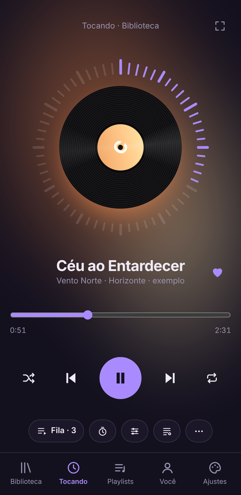

# Compasso Player

An **offline** music player with **customizable themes**. Your music, playlists and themes stay on your device: no account, no server, no ads, and nothing is sent to the internet. `index.html` ships a Content Security Policy that forbids any outside connection.

It runs in the browser on phones and desktops and can be installed as an app (PWA).

**[Open the app](https://kirarahoshi.github.io/compasso-player/)** · *[Leia em português](README.md)*

> The app interface is currently in Brazilian Portuguese. An English translation is planned.

| Library | Now playing | Vinyl (70s) |
|---|---|---|
|  |  |  |

## Features

- **Library:** import files or whole folders (drag and drop on desktop). Reads title, artist, album, track number, cover art and lyrics from MP3, FLAC, M4A, OGG and Opus, with no external libraries. Songs, albums, artists and folders, global search and multi-select.
- **Now playing:** the cover sits inside a clock dial whose 60 ticks follow the song and react to the sound. Other visuals: vinyl, cassette, radio, bars and wave. Full screen turns it into a clock that plays music.
- **Sound eras:** 60s tube radio, 70s vinyl with crackle, 80s cassette and 90s CD.
- **Playback:** gapless track change, crossfade, speed, volume leveling, 5 or 10 band equalizer with 15 presets, sleep timer.
- **Queue and playlists:** play next, reorder by dragging, favorites and four automatic playlists.
- **Lyrics:** read from tags or `.lrc` files, synced karaoke-style, editable.
- **You:** a local profile with listening time, most played songs and a yearly recap you can share as an image.
- **Themes:** two free themes, a theme editor with contrast checking, a built-in gallery, and JSON import/export. The same theme format works in [Caixinhas Orologia](https://github.com/KiraraHoshi/caixinhas-orologias).
- **Backup:** playlists, favorites, statistics, lyrics, profile, themes and settings in one file.

## Run locally

```bash
python -m http.server 8000
```

Then open `http://localhost:8000`.

## License

MIT. See `LICENSE`.
