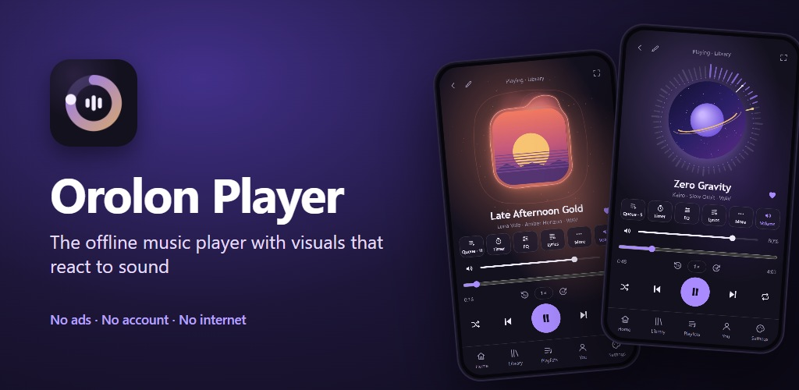
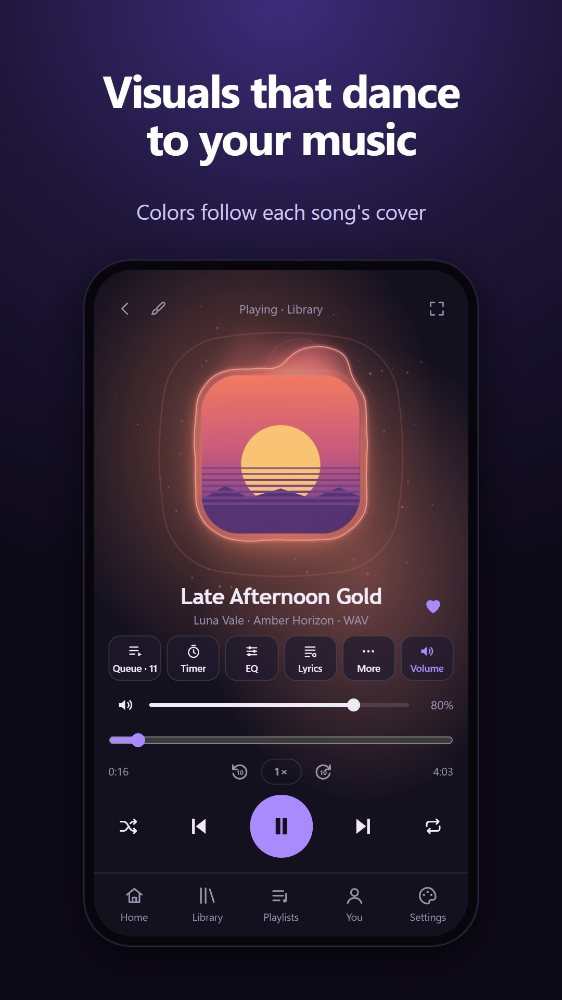
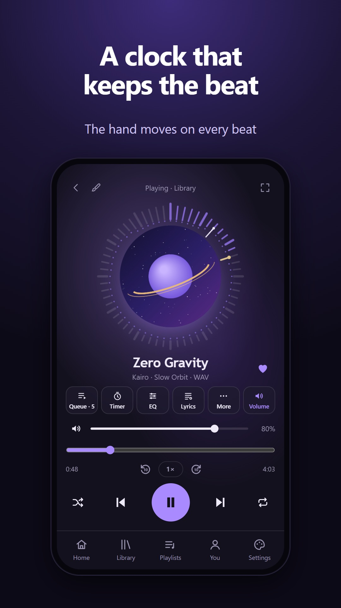
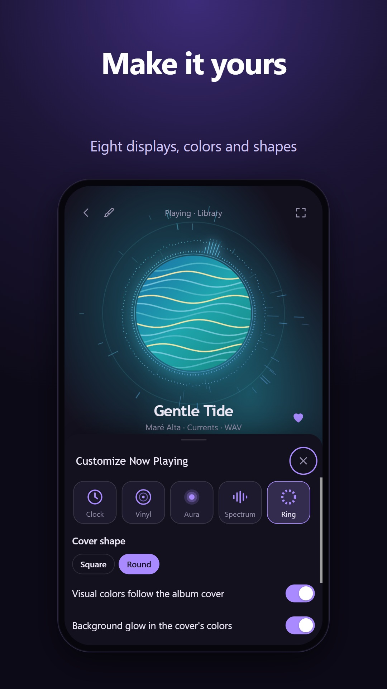
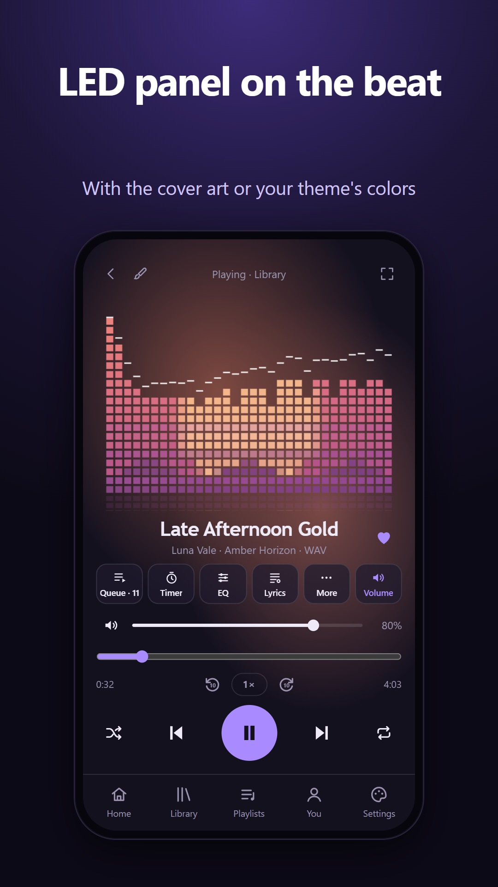
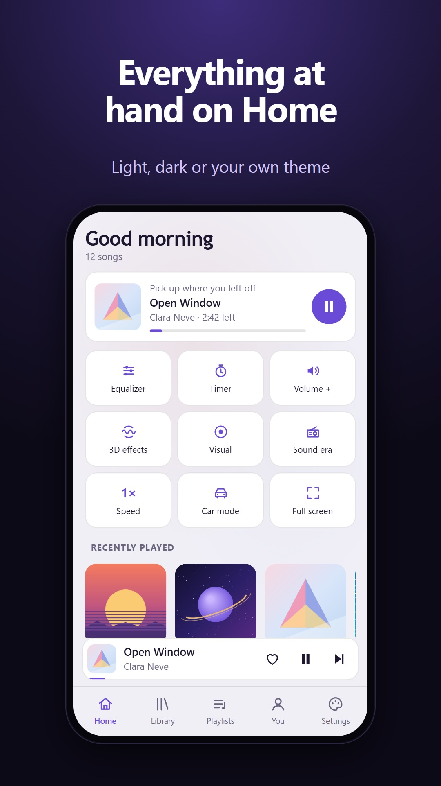
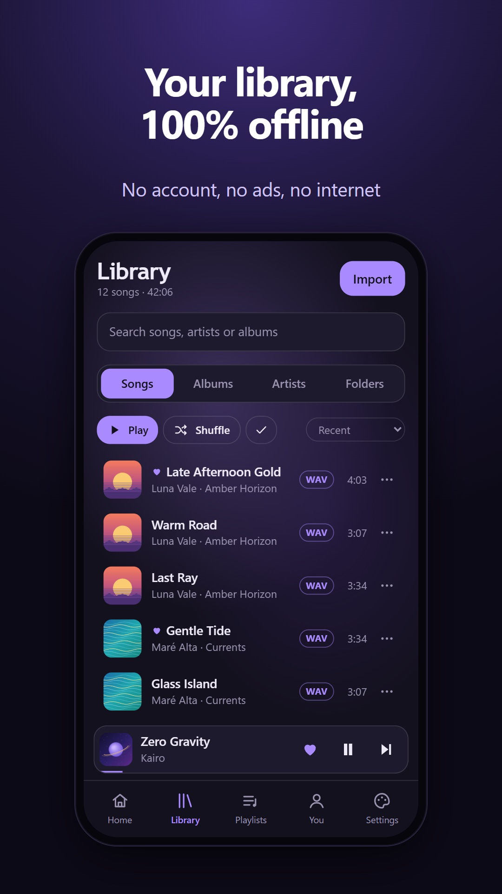
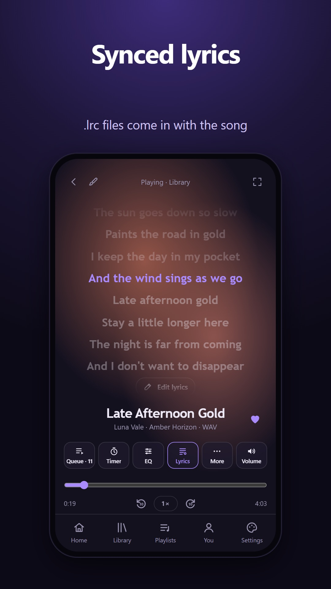
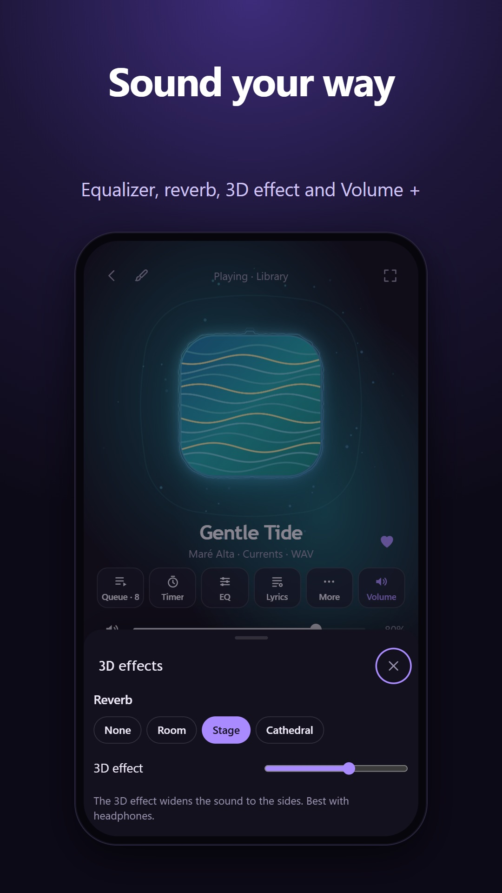

# Orolon Player

An **offline** music player with **customizable themes**. Your music, playlists and themes stay on your device: no account, no server, no ads, and nothing is sent to the internet. `index.html` ships a Content Security Policy that forbids any outside connection.

It runs in the browser on phones and desktops, can be installed as an app (PWA), and has an Android version (in closed testing on Google Play).

**[Open the app](https://kirarahoshi.github.io/compasso-player/)** · *[Leia em português](README.md)*

The app follows your device language (English or Brazilian Portuguese), and you can switch it in **Settings › Language**.



<p>








</p>

## Features

- **Home:** continue where you left off, shortcuts to the tools (equalizer, sleep timer, Volume +, 3D effects, car mode and more), recently played and favorites.
- **Library:** import files or whole folders (drag and drop on desktop; on Android it finds the music on the device by itself). Reads title, artist, album, track number, cover art and lyrics from MP3, FLAC, M4A, OGG and Opus, with no external libraries. Songs, albums, artists and folders, global search, multi-select, more sort orders and 1 to 5 star ratings.
- **Now playing:** the cover sits inside a dial that reacts to the music, hearing kick, snare and cymbals and following the tempo. The brush button changes the visual, colors and cover right there.
- **Dial visuals:** Clock (with hands), Vinyl, Aura, Spectrum, Ring, Neon, Bars and LED. Aura has styles (Default, Phonk, Lo-fi and 80s). Full screen turns it into a clock that plays music.
- **Sound:** volume boost up to 200% with a limiter, reverb, 3D effect and enhancer (bass, treble and intensity), all free.
- **Car mode:** a simple screen with big buttons. On Android it pauses when headphones are unplugged and can start playing when they connect.
- **Sound eras:** 60s, 70s, 80s and 90s, each with its own sound and visual.
- **Playback:** gapless track change, crossfade, speed, volume leveling, 5 or 10 band equalizer with 15 presets, sleep timer, A-B repeat and bookmarks for long audio.
- **Queue and playlists:** play next, reorder by dragging, favorites, four automatic playlists and `.m3u` import/export.
- **Lyrics:** read from tags or `.lrc` files, synced karaoke-style, editable.
- **You:** a local profile with listening time, most played songs and a yearly recap you can share as an image.
- **Themes:** two free themes, a theme editor with contrast checking, a built-in gallery, and JSON import/export. The same theme format works in [Caixinhas Orologia](https://github.com/KiraraHoshi/caixinhas-orologias).
- **Own volume control**, separate from the device volume, with mute and keyboard shortcuts.
- **Light mode** for simpler devices. The app suggests it when it notices it is running slowly.
- **Backup:** playlists, favorites, statistics, lyrics, profile, themes and settings in one file. You can also send it through another app or keep a daily automatic copy in a folder you choose.
- **Custom covers** for albums and songs, without touching the original file.
- **Desktop shortcuts:** space plays and pauses, ← and → seek 5 seconds, N and P change tracks, F favorites, Esc goes back one step, 1 to 5 switch tabs and / opens search.

## Android

The same app packaged with [Capacitor](https://capacitorjs.com/), without the internet permission. Google Play: in closed testing. Test APK: **Releases** › "Android (teste)". Details in [ANDROID.md](ANDROID.md) (Portuguese).

## Translations

All texts live in `js/i18n.js`. The Portuguese text is the key and `EN` holds the English. To add a language, copy `EN`, translate the values and register it in `IDIOMAS`.

## Run locally

```bash
python -m http.server 8000
```

Then open `http://localhost:8000`.

## License

MIT. See `LICENSE`.
