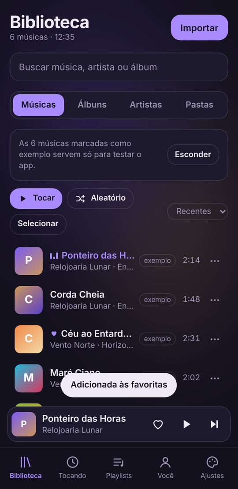
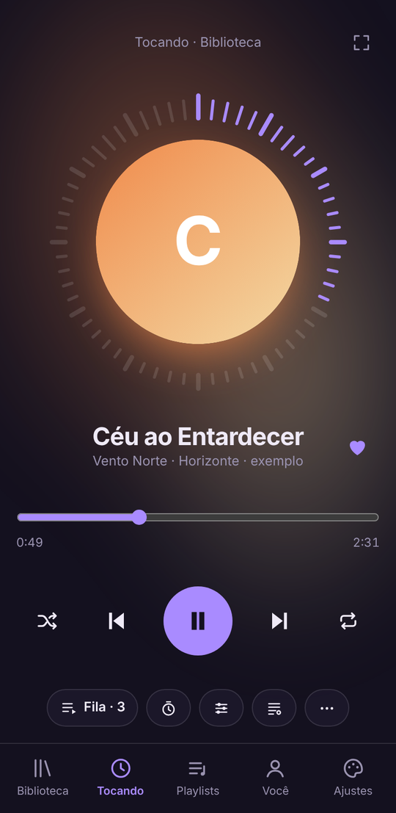
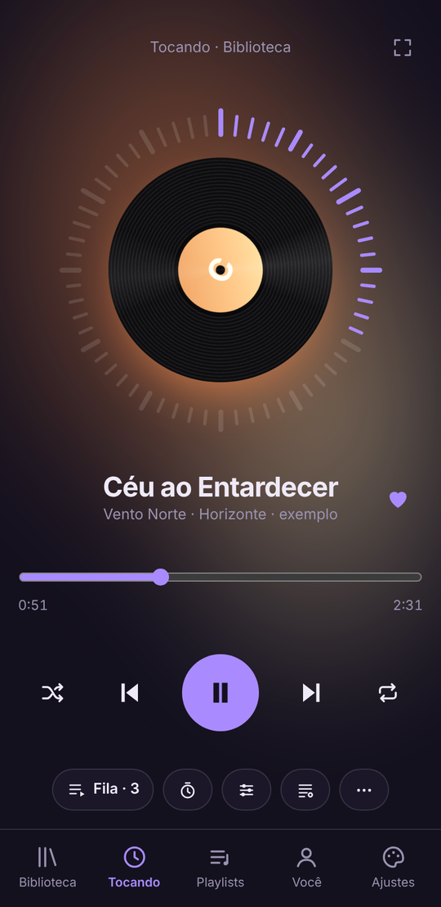
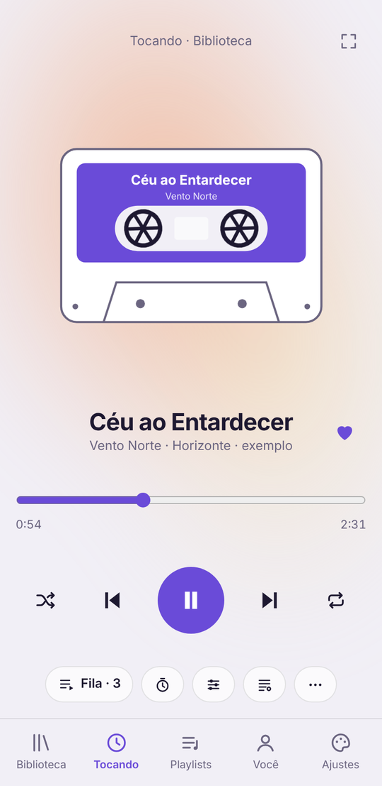
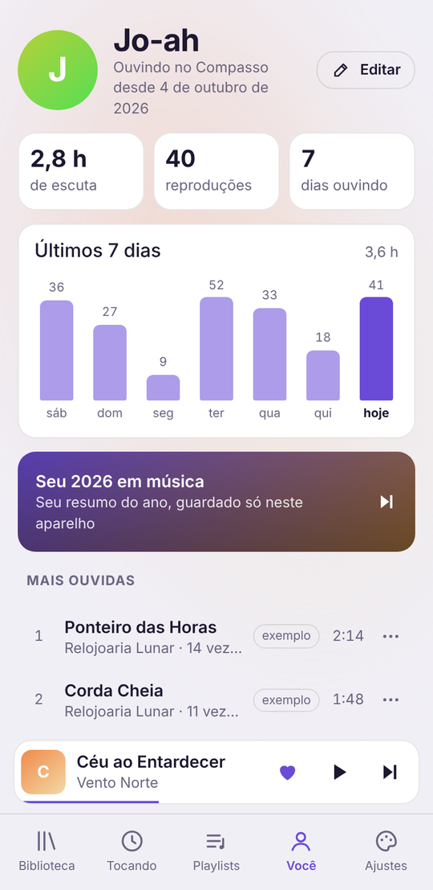
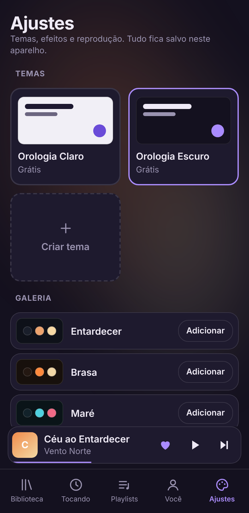

# Orolon Player

Player de música **offline** com **temas customizáveis**. As músicas, as playlists e os temas ficam só no seu aparelho: o app não tem conta, não tem servidor e não envia nada para a internet. O `index.html` traz uma política de segurança (CSP) que proíbe qualquer conexão para fora.

Funciona no navegador do celular e do PC e pode ser instalado como app (PWA).

**[Abrir o app](https://kirarahoshi.github.io/compasso-player/)**

| Biblioteca | Tocando agora | Vinil (anos 70) |
|---|---|---|
|  |  |  |

| Cassete (anos 80) | Você | Ajustes |
|---|---|---|
|  |  |  |

*[Read in English](README.en.md)* · [Histórico de versões](CHANGELOG.md) · [Planos](ROADMAP.md)

## O que ele faz

- **Biblioteca:** importa arquivos ou pastas inteiras (no PC, também dá para arrastar para a janela). Lê título, artista, álbum, número da faixa e capa de MP3, FLAC, M4A, OGG e Opus. Abas de músicas, álbuns e artistas, com busca e ordenação.
- **Tocando agora:** a capa fica dentro de um mostrador de relógio. Os 60 tracinhos marcam o tempo da música e reagem ao som, e o mostrador pulsa nas batidas graves.
- **Luz de fundo:** um brilho com as cores da capa, que troca com fade a cada música.
- **Fila:** tocar a seguir, adicionar ao fim, tirar, limpar e reordenar arrastando. Ordem aleatória e repetir (fila ou uma música).
- **Playlists:** criar, renomear, apagar, adicionar músicas e reordenar arrastando.
- **Temas:** dois temas grátis (Orologia Claro e Orologia Escuro), ajuste rápido de cor e cantos, e um editor para criar temas próprios com verificação de contraste. Temas podem ser exportados e importados em JSON.
- **Você:** perfil local (nome e foto), tempo de escuta, reproduções, últimos 7 dias, mais ouvidas e o Recap do ano. Sem conta e sem nada online.
- **Favoritas e playlists automáticas:** Favoritas, Adicionadas recentemente, Tocadas recentemente e Mais tocadas.
- **Equalizador** de 5 ou 10 bandas com 15 predefinições, **temporizador de sono** e fade ao pausar e tocar.
- **Letras:** lidas das tags da música ou de um arquivo .lrc com o mesmo nome, sincronizadas no estilo karaokê. Dá para colar e editar.
- **Organização:** aba de Pastas, editor de informações (sem mexer no arquivo original) e músicas ocultas.
- **Imagem de fundo** escolhida por você, com desfoque.
- **Backup:** playlists, favoritas, estatísticas, letras, perfil, temas e ajustes num arquivo, para levar a outro aparelho.
- **Recap em imagem:** o resumo do ano vira uma imagem para compartilhar.
- **Épocas do som:** anos 60 (rádio valvulado), 70 (vinil com estalos), 80 (cassete) e 90 (CD), cada uma com seu visual.
- **Visuais do mostrador:** relógio, vinil, cassete, rádio, barras e onda. Em tela cheia, vira um relógio que toca.
- **Troca sem pausa e crossfade**, velocidade de reprodução e opção de nivelar o volume.
- **Busca geral e seleção múltipla** na Biblioteca.
- **Galeria de temas** dentro do app e na pasta [`temas/`](temas/).
- **Volume próprio**, separado do volume do aparelho, com mudo e atalhos no teclado.
- **Modo leve** para aparelhos mais simples, e o app sugere ligar quando percebe que está lento.
- **Português e inglês**, escolhido pelo idioma do aparelho ou em Ajustes.
- **Volta de onde parou:** ao reabrir, a fila e a posição da música continuam iguais.
- **Controles do sistema:** tela de bloqueio, fones Bluetooth e teclas de mídia.
- **Atalhos no PC:** espaço toca e pausa, ← e → voltam ou avançam 5 segundos, N e P trocam de música, F favorita.

## Usar

1. Abra **[kirarahoshi.github.io/compasso-player](https://kirarahoshi.github.io/compasso-player/)** no celular ou no PC.
2. Toque em **Importar** e escolha suas músicas ou uma pasta inteira. No PC, também dá para arrastar para a janela.
3. Para instalar como app, use **Instalar app** ou **Adicionar à tela inicial** no menu do navegador. Depois disso ele abre mesmo sem internet.

O app abre em português ou inglês conforme o idioma do aparelho, e dá para trocar em **Ajustes › Idioma**. Se o celular for mais simples ou a rolagem travar, ligue **Ajustes › Efeitos › Modo leve**.

### Para quem quer mexer no código

Para testar no PC sem publicar:

```bash
python -m http.server 8000
```

e abra `http://localhost:8000`.

## Publicar no GitHub Pages

1. Crie um repositório e envie todos os arquivos desta pasta para a raiz dele.
2. Em **Settings › Pages**, escolha **Deploy from a branch**, a branch `main` e a pasta `/ (root)`.
3. Em um ou dois minutos o app fica em `https://SEU-USUARIO.github.io/NOME-DO-REPOSITORIO/`.

Depois de publicar uma versão nova, quem já usa o app recebe a atualização ao abrir duas vezes (a primeira baixa, a segunda mostra). Se mudar a lista de arquivos, atualize também `ARQUIVOS` em `sw.js`.

## Formato do tema

Um tema é um JSON pequeno. As cores precisam estar em `#RRGGBB`.

```json
{
  "formato": "orologia-tema",
  "versao": 1,
  "nome": "Orologia Escuro",
  "fundo": "#14111F",
  "card": "#1E1A2E",
  "texto": "#EFEAF7",
  "suave": "#9A93B0",
  "destaque": "#A98BFF",
  "secundaria": "#D2A067",
  "raio": 16,
  "fonte": "padrao"
}
```

- `raio`: cantos arredondados, de 0 a 28.
- `fonte`: `padrao`, `sistema`, `serifada` ou `mono`. A fonte `padrao` usa Bricolage Grotesque e Figtree quando estão instaladas no aparelho; senão, a do sistema.

O formato é o mesmo do [Caixinhas Orologia](https://github.com/KiraraHoshi/caixinhas-orologias): um tema feito num app funciona no outro.

## Limitações conhecidas

- O navegador guarda uma cópia de cada música importada, então elas ocupam espaço duas vezes.
- Em alguns celulares, o sistema pode pausar a reprodução com a tela desligada. A versão Android nativa vai resolver isso.
- As músicas de exemplo são sintetizadas na hora e não aparecem nos controles da tela de bloqueio.

## Estrutura

```
index.html          telas do app
css/app.css         visual (todas as cores vêm do tema)
js/i18n.js          idiomas (o dicionário de inglês fica aqui)
js/tags.js          leitura de tags e capas dos arquivos de áudio
js/app.js           biblioteca, fila, reprodução, playlists e temas
sw.js               modo offline
manifest.json       dados para instalar como app
icons/              ícones do app
temas/              galeria de temas em JSON
docs/               capturas de tela
```

## Licença

MIT. Veja `LICENSE`.
